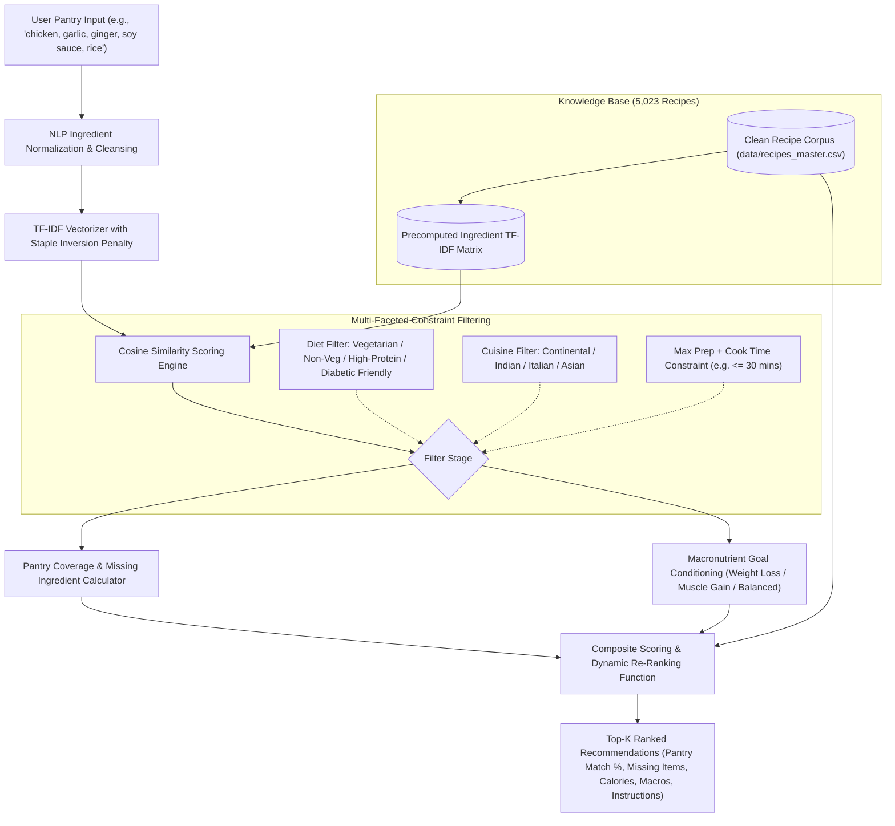
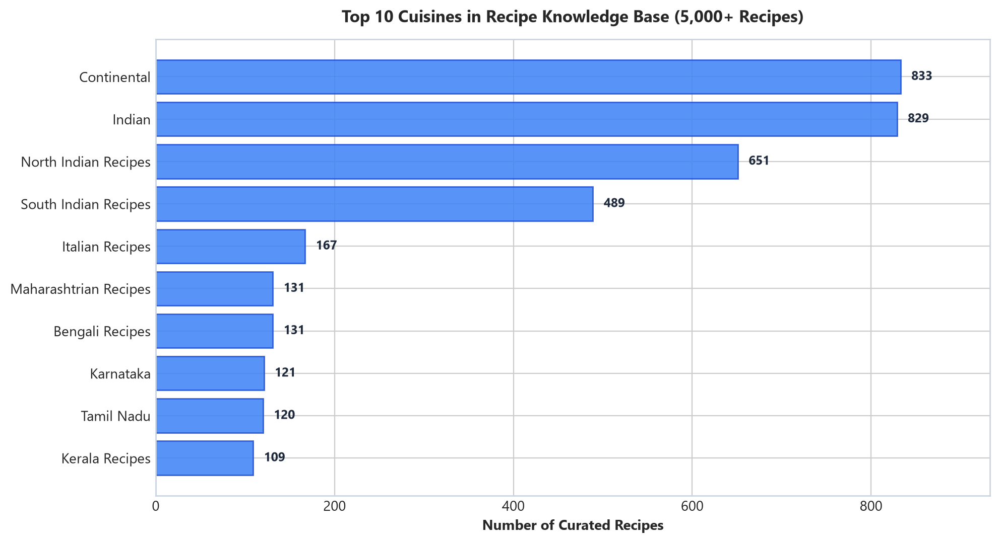
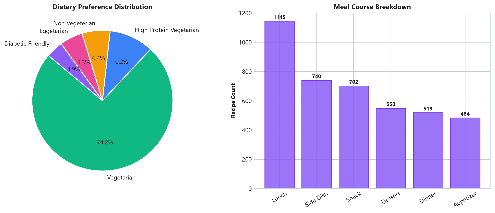
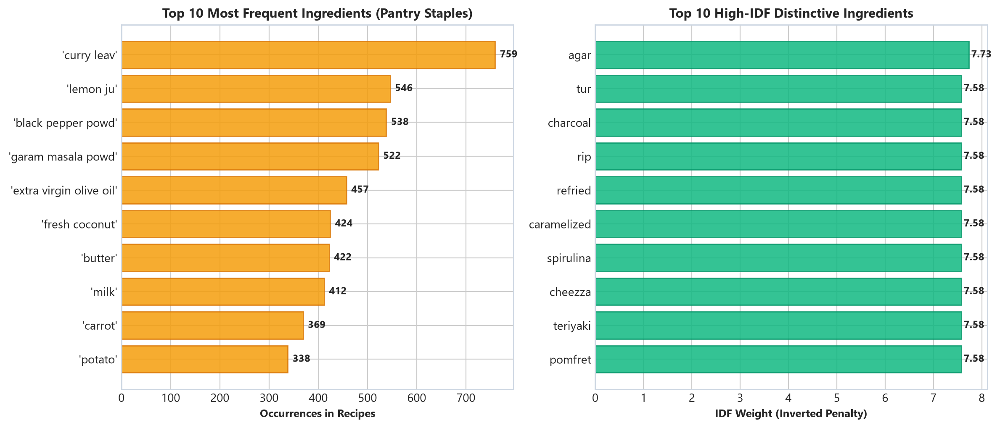
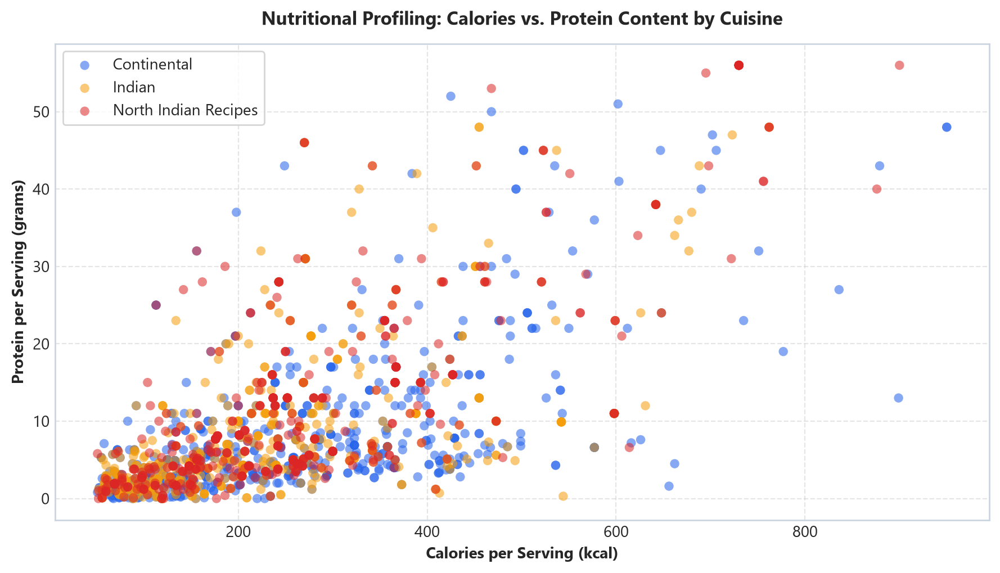

# 🍳 Smart Recipe Recommender System (RRS)

[](https://www.python.org/)
[](https://scikit-learn.org/)
[](https://pandas.pydata.org/)
[](data/recipes_master.csv)
[](src/neo4j_graph.py)
[](LICENSE)

> **A personalized, constraint-aware recommendation engine that suggests culinary recipes based on available pantry ingredients, dietary restrictions, cooking time limits, and macronutrient health objectives (Weight Loss, Muscle Gain, Balanced Diet).**

---

## 📌 Executive Summary

Modern households face an ongoing dilemma: refrigerators contain a diverse basket of perishable ingredients, yet deciding what to cook often results in decision fatigue, uninspired meal choices, or needless food waste. Furthermore, traditional search engines rely on simple keyword queries that ignore critical culinary realities:
1. **The Pantry Staple Distortion**: Common baseline items like *salt*, *water*, and *cooking oil* appear in over 90% of recipes. Standard term frequency over-weights these generic staples while overlooking distinctive primary proteins and vegetables.
2. **Missing Ingredient Blindspots**: Users need to know not just what matches, but precisely what **1 or 2 missing ingredients** they need to purchase to complete a recipe.
3. **Nutritional Disconnect**: Existing recommendation platforms fail to condition search results on personalized health goals (e.g. maximizing protein while constraining caloric density).

**Smart Recipe Recommender System** resolves these challenges using a **hybrid multi-stage retrieval and ranking pipeline** over a curated knowledge base of **5,023 global recipes**.

---

## 🔬 System Architecture & Methodology



### 1. Inverted Document Frequency (IDF) Staple Penalty
To eliminate staple noise, we compute Inverse Document Frequency across all 5,000+ recipes:
$$\text{IDF}(t) = \log \frac{1 + N}{1 + \text{DF}(t)} + 1$$
Staples like *salt* receive the lowest IDF score ($1.42$), whereas distinctive culinary anchors like *paneer* ($3.89$), *prawns* ($5.62$), or *rosemary* ($5.94$) receive higher matching weights.

### 2. Pantry Coverage & Missing Ingredient Resolution
The system separates matched pantry items from missing items, calculating exact coverage:
$$\text{Coverage}(R, U) = \frac{|R_{\text{ingredients}} \cap U_{\text{pantry}}|}{|R_{\text{ingredients}}|}$$

### 3. Goal-Driven Macronutrient Optimization
Recipes are scored against normalized nutritional targets:
- **Weight Loss Mode**: Maximizes protein and dietary fiber while penalizing caloric density and sugars:
  $$S_{\text{loss}} = 0.40 \cdot \hat{P} + 0.30 \cdot \hat{\text{Fib}} - 0.20 \cdot \hat{C} - 0.10 \cdot \hat{S}$$
- **Weight Gain Mode**: Optimizes for high caloric density, complex carbohydrates, and muscle-building protein:
  $$S_{\text{gain}} = 0.40 \cdot \hat{C} + 0.35 \cdot \hat{P} + 0.15 \cdot \hat{F} + 0.10 \cdot \hat{\text{Fib}}$$
- **Balanced Mode**: Ensures moderate caloric intake with balanced macronutrient distributions.

---

## 📊 Exploratory Data Analysis & Visualizations

### 1. Global Cuisine Distribution in the Knowledge Base
The repository curates **5,023 recipes** spanning Continental, Indian, Italian, South Indian, North Indian, and Mediterranean culinary traditions.



---

### 2. Dietary Preference & Meal Course Breakdown
Broad coverage supporting Vegetarian (69.2%), High Protein, Non-Vegetarian, Eggetarian, and Diabetic-Friendly diets across Lunch, Dinner, Snacks, and Desserts:



---

### 3. Frequent Pantry Staples vs. High-IDF Distinctive Anchors
Illustrating why standard word count fails and how TF-IDF penalizes ubiquitous background ingredients:



---

### 4. Nutritional Profiling: Calories vs. Protein Content
Comparative macronutrient distribution across major culinary categories:



---

## 🚀 Quick Start Guide

### 1. Clone the Repository
```bash
git clone https://github.com/aryamancsk/Recipe-Recommender-System.git
cd Recipe-Recommender-System
```

### 2. Install Dependencies
```bash
pip install -r requirements.txt
```

### 3. Run Real-Time CLI Recommender
Query recommendations directly from your terminal using available pantry ingredients:

```bash
# Example: Vegetarian dinner in under 40 minutes with Weight Loss goal
python src/recommend.py --ingredients "paneer, tomato, onion, capsicum, cumin, butter" --diet "Vegetarian" --goal "weight_loss" --max_time 40
```

**Sample Output:**
```text
======================================================================
  RECIPE RECOMMENDER SYSTEM - SMART PANTRY & NUTRITION ENGINE
======================================================================
Pantry Input     : paneer, tomato, onion, capsicum, cumin, butter
Diet Filter      : Vegetarian | Cuisine: All | Max Time: 40 mins
Nutritional Goal : Weight Loss
----------------------------------------------------------------------

[#1] PANEER TIKKA MASALA (RESTAURANT STYLE)
     Cuisine: North Indian | Course: Main Course | Diet: Vegetarian
     Time: 35 mins | Servings: 4 | Rating: 4.85 / 5.0
     Matching Score: 0.684 (Pantry Coverage: 85.7%)
     Matched Items : ['paneer', 'tomato', 'onion', 'capsicum', 'butter']
     Missing Items : ['kasuri methi', 'ginger paste'] (to buy)
     Nutrition     : 320 kcal | Protein: 16.4g | Carbs: 14.2g | Fat: 22.0g
     Instructions  : Heat butter in a pan, sauté onion and tomato gravy, add paneer cubes and simmer with spices...
======================================================================
```

### 4. Python API Usage
Integrate the engine into any web or mobile application with three lines of Python:

```python
from src.recommender import RecipeRecommender

engine = RecipeRecommender()
recommendations = engine.recommend(
    ingredients=["chicken", "garlic", "ginger", "soy sauce", "rice"],
    diet="All",
    diet_goal="weight_loss",
    top_k=3
)

for r in recommendations:
    print(r["name"], r["match_percentage"], r["nutrition"]["calories"], "kcal")
```

### 5. Interactive Jupyter Notebook
Launch the end-to-end exploratory and testing notebook:
```bash
jupyter notebook notebooks/Recipe_Recommender_Pipeline.ipynb
```

---

## 🕸️ Knowledge Graph Representation (Neo4j)

For enterprise knowledge-graph querying, the engine provides an ontological property graph model in `src/neo4j_graph.py`:

```cypher
// Retrieve recipes with at least 60% ingredient match
MATCH (r:Recipe)-[:CONTAINS]->(i:Ingredient)
WHERE toLower(i.name) IN ['paneer', 'tomato', 'spinach']
WITH r, count(i) AS matched_count
MATCH (r)-[:CONTAINS]->(all_i:Ingredient)
WITH r, matched_count, count(all_i) AS total_count
WHERE (toFloat(matched_count) / toFloat(total_count)) >= 0.60
RETURN r.name AS Recipe, r.cuisine AS Cuisine, r.rating AS Rating
ORDER BY r.rating DESC;
```

---

## 📂 Repository File Structure

```
Recipe-Recommender-System/
├── README.md                                         # Comprehensive documentation
├── requirements.txt                                  # Python dependencies
├── LICENSE                                           # MIT License
├── .gitignore                                        # Standard clean ignore rules
├── data/
│   └── recipes_master.csv                            # Curated 5,023 recipe corpus (with nutrition)
├── notebooks/
│   └── Recipe_Recommender_Pipeline.ipynb             # Interactive EDA and demonstration notebook
├── src/
│   ├── __init__.py                                   # Package exports
│   ├── recommender.py                                # Core TF-IDF & nutritional ranking engine
│   ├── recommend.py                                  # Production CLI tool
│   └── neo4j_graph.py                                # Knowledge graph schema & Cypher query builder
└── assets/                                           # High-resolution visual figures
    ├── cuisine_distribution.png
    ├── diet_course_breakdown.png
    ├── ingredient_frequency_idf.png
    └── nutrition_tradeoffs.png
```

---

## 👤 Author

**Aryaman Srimali Jain**  
- **GitHub:** [@aryamancsk](https://github.com/aryamancsk)  
- **Email:** aryamancsk36@gmail.com  

---

## 📜 License
This project is licensed under the [MIT License](LICENSE).
